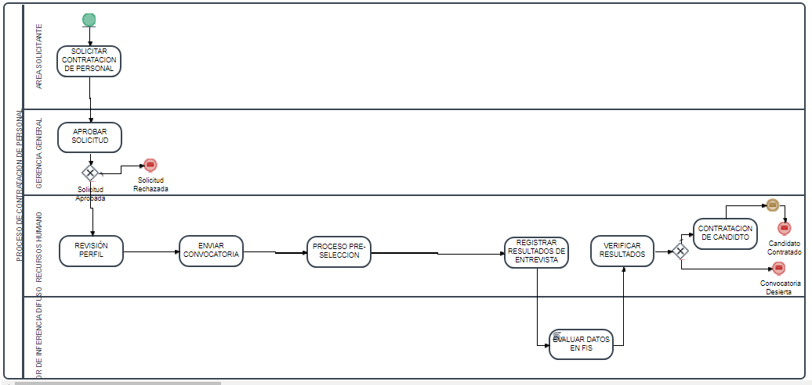
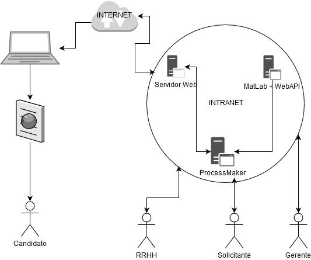
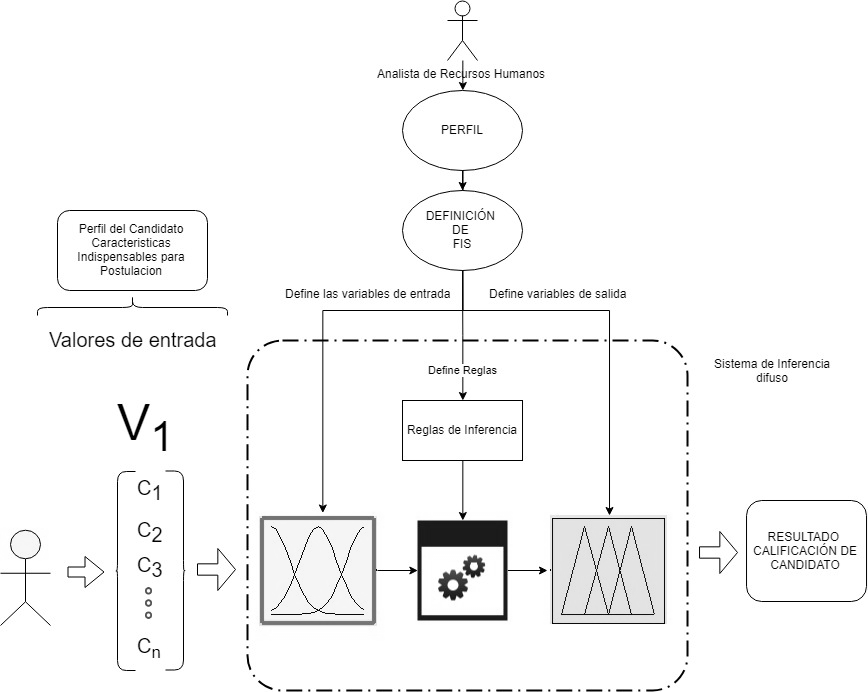
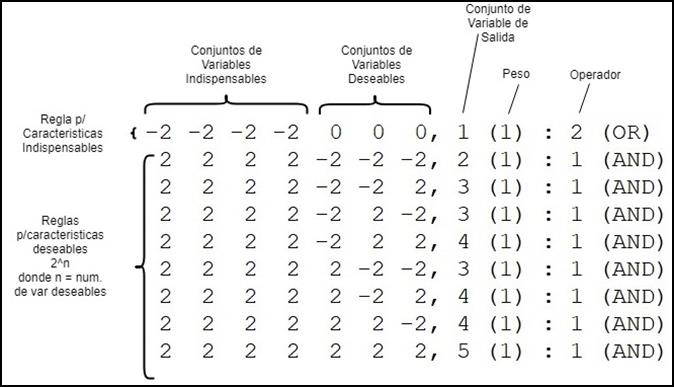
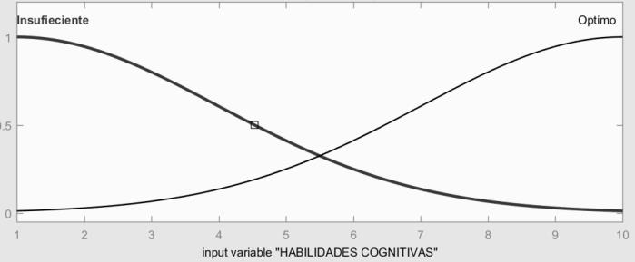
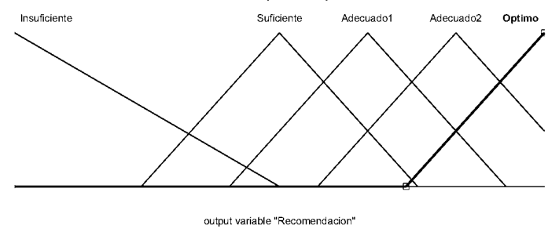

# Automatización del proceso de contratación de personal con BPM y lógica difusa

**Proyecto de Grado de Ingeniería de Sistemas — Universidad Católica Boliviana "San Pablo", La Paz (2018)**
Autor: **Angel Guillermo Morales Romero** · Tutor: **Prof. Miguel Ángel Villarroel Salgueiro**
Calificación: **85 puntos, con mención de honor** (reconocida por la universidad, el relator y el tutor).

*Em português:* projeto de graduação em Engenharia de Sistemas (2018). Um processo de recrutamento modelado em BPM (ProcessMaker) passa a tomar decisões com um sistema de inferência difusa (MATLAB), conectados por uma API REST que desenvolvi em VB.NET. É o antecessor direto do meu TCC da pós-graduação em IA (2026), que leva a mesma ideia — IA aplicada a processos BPM — para Reinforcement Learning com Graph Neural Networks.

*In English:* Systems Engineering capstone project (2018). A recruitment workflow modeled in a BPM suite (ProcessMaker) delegates its final-interview decision to a Mamdani fuzzy inference system (MATLAB), connected through a REST API I built in VB.NET / WCF. It is the direct predecessor of my 2026 postgraduate thesis, which takes the same idea — AI inside BPM processes — to Reinforcement Learning with Graph Neural Networks.

---

## El problema

La selección de personal depende de evaluaciones de aptitudes y actitudes que son imprecisas por naturaleza: el estrés, el cansancio o los sesgos del evaluador y del candidato pueden llevar a contratar a la persona equivocada. Además, el proceso suele ser lento, manual y difícil de controlar.

**Pregunta de investigación:** ¿cómo aplicar BPM y lógica difusa a la selección y contratación de personal de forma práctica y viable para organizaciones sin especialistas en IA ni un departamento de TI grande?

## La solución

Un sistema compuesto por tres piezas:

1. **Proceso BPM (ProcessMaker 3.2, código abierto).** Modela el ciclo completo: solicitud del área, aprobación de gerencia, perfil del cargo, convocatoria, postulación web, filtro de CV, entrevista final, evaluación automática y contratación, con notificaciones por correo en cada etapa.
2. **Sistema de inferencia difusa tipo Mamdani (MATLAB, Fuzzy Logic Toolbox).** Califica a los candidatos de la entrevista final según el perfil del cargo.
3. **API web REST (VB.NET, WCF, .NET 4.0) — desarrollada por mí.** Conecta ProcessMaker con MATLAB vía automatización COM y **genera el modelo difuso de forma dinámica** a partir del perfil definido por RRHH.





## El modelo difuso

El analista de RRHH define el perfil del cargo con dos tipos de características:

- **Indispensables:** si el candidato no cumple alguna, queda descartado.
- **Deseables:** cada una que cumple aumenta su calificación.

A partir de ese perfil la API construye el sistema difuso:

- **Entradas:** una variable por característica (escala 1–10), con dos funciones de pertenencia gaussianas: *Insuficiente* y *Óptimo*.
- **Salida "Recomendación":** conjuntos triangulares *Insuficiente*, *Suficiente*, *Adecuado 1…N-1* y *Óptimo*, repartidos según el número de características deseables.
- **Reglas generadas automáticamente:** una regla OR para el caso *Insuficiente* y 2ⁿ reglas AND que cubren todas las combinaciones de características deseables (n = número de deseables).
- **Inferencia:** min/max, implicación min y defuzzificación por centroide.

| Generación del sistema a partir del perfil | Reglas generadas |
|---|---|
|  |  |

| Variable de entrada | Variable de salida |
|---|---|
|  |  |

## La API REST

| Método | Ruta | Qué hace |
|---|---|---|
| `POST` | `api/perfilcargo` | Recibe el perfil (características indispensables y deseables) y genera y guarda el `.fis` en MATLAB. |
| `POST` | `api/perfilcargopesos` | Igual, con pesos por característica deseable. |
| `GET` | `api/{perfil}/{param}` | Evalúa a un candidato: carga el `.fis` del perfil y ejecuta `evalfis` con sus calificaciones. Devuelve la recomendación (0–10). |

ProcessMaker llama a la API desde *triggers* en PHP (cURL) y muestra el resultado al jefe de RRHH, que toma la decisión final de contratación.

## Resultados

- Proceso de selección y contratación modelado y automatizado en ProcessMaker, incluido el formulario de postulación web.
- Sistema de inferencia difusa para la entrevista final, con generación dinámica a partir del perfil.
- API REST funcionando entre el BPM y MATLAB.
- Validado con un caso real de una empresa boliviana (contratación de un ingeniero de servicio técnico): el sistema reprodujo los resultados documentados por la empresa (Anexo A del documento).

## Contenido del repositorio

```
api/                 API REST en VB.NET (WCF, .NET 4.0) — solución de Visual Studio
modelos-fis/         modelos difusos de MATLAB (.fis): perfil del caso de estudio y perfil de ejemplo
processmaker/        exportación del proceso (.pmx) y de las tablas (.pmt) de ProcessMaker 3.2
docs/                documento del proyecto (versión anonimizada), paper en formato IEEE y póster
img/                 diagramas y figuras usados en este README
```

## Tecnologías

ProcessMaker 3.2 (BPM, BPMN, PHP) · MATLAB Fuzzy Logic Toolbox · VB.NET / WCF / ASP.NET (.NET 4.0) · REST / JSON · MySQL · Visual Studio 2015

## Cómo ejecutarlo (referencia)

Es un proyecto de 2018 y depende de software de esa época:

1. Instalar ProcessMaker 3.2.x e importar `processmaker/Contratacion_de_Personal.pmx` (y las tablas de `tablas_pmtables.pmt`).
2. Instalar MATLAB con Fuzzy Logic Toolbox y registrarlo como servidor COM (`matlab -regserver`).
3. Abrir `api/ServicioFis.sln` en Visual Studio, publicar el servicio en IIS y apuntar a su URL los *triggers* de ProcessMaker.
4. Copiar el `.fis` del perfil a la carpeta Documentos del usuario que ejecuta el servicio (ahí lo busca la API).

## Documentos

- [Documento del Proyecto de Grado (versión anonimizada)](docs/Proyecto_de_Grado_AGMR_2018_anonimizado.pdf)
- [Paper en formato IEEE](docs/Paper_IEEE_AGMR_2018.pdf)
- [Póster — Workshop de Tecnología de la Información y Comunicación Aplicada (2018-I)](docs/Poster_Workshop_2018.pdf)

> **Privacidad:** en la versión publicada del documento se reemplazaron por alias los nombres y datos personales que aparecían en las capturas de pantalla, y se omitió el nombre de la empresa del caso de estudio.

## Autor

**Angel Guillermo Morales Romero** — [Portafolio](https://aguilhermemr.github.io) · [LinkedIn](https://www.linkedin.com/in/angel-guillermo-morales-romero) · [GitHub](https://github.com/aguilhermemr)
